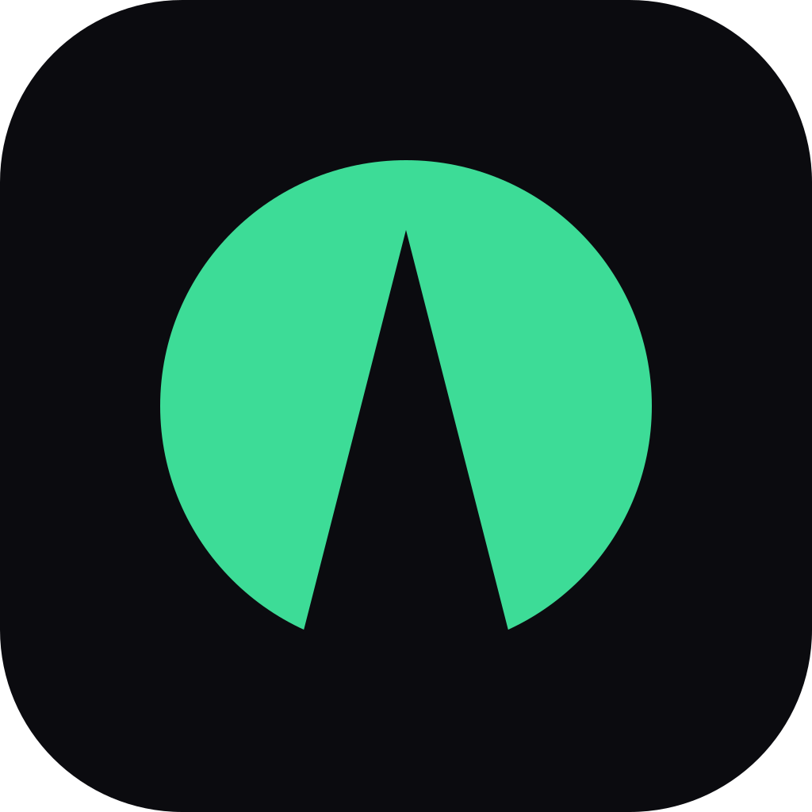

  

<h1 align="center">Akidev</h1>

  Anime, series and films in one place. 
  On the web, on your computer, and on your TV.

Akidev puts three catalogues side by side: anime, series and films. You search once, pick a title, and press Play. Akidev finds a copy to stream, so you do not browse torrent sites or sort through file names.

It looks and feels the same everywhere: a near-black screen, grey cards, and one amber accent, so the artwork is the colour.

## Get Akidev

| Where | What it is | How to get it |
| --- | --- | --- |
| **Web** | The full site in any browser | Open [akidev.live](https://akidev.live) |
| **Desktop** | A native app for macOS and Windows | Download it from [Releases](https://github.com/dishant0406/akidev/releases) (look for `desktop-mac` or `desktop-windows`) |
| **Android TV** | Made for the remote and the big screen | Download the APK from [Releases](https://github.com/dishant0406/akidev/releases) (look for `tv-android`). After that, the app updates itself |
| **Aki Manga** | A separate app for reading manga, manhwa and EPUB books, on iPhone and Android | See [the iPhone app](apps/manga-ios/README.md) and [the Android app](apps/manga-android/README.md) |

## What you can do

- **Browse and search.** Home, Anime, Series and Films each have their own rows. Search covers all three at once, so "Breaking Bad" and "Dangal" both turn up.
- **Pick up where you stopped.** A "Continue watching" row brings you back to your last title, at the minute you left.
- **Choose how to watch.** Every copy that Akidev finds is listed, so you can switch if one is slow or has the wrong language. Subtitles and audio tracks are in the same panel.
- **Binge.** The next episode is one press away, and Akidev offers it as the current one ends.
- **Watch together.** Start a party and guests, on the desktop app or the website, see the same title in step with you. Anyone can pause or seek for everyone. Only "what to play and where" is shared, so each person streams their own copy.
- **Read.** Aki Manga keeps your library, finds new chapters, and can read a book aloud.

## Good to know

- **Akidev has no video library of its own.** It finds copies that already exist, such as torrent releases, and plays them. A title with no copy shows a clear message rather than a broken player.
- **Hollywood has more copies than Bollywood.** Some regional films and series have few releases, or none. This is the limit of finding copies this way, not a bug.
- **The TV app needs a TorBox account.** On the TV you enter your own TorBox key once in Settings. It stays on the TV and goes only to TorBox.
- **Seeking in an episode that is still being prepared** works only as far as the part that is ready.

## Why it feels fast

Akidev is built around not making you wait.

- Pages arrive with their content already in them, instead of showing a spinner first.
- Pictures are resized once and kept, so the website's home page loads about a third of the picture data it did before.

## For developers

Everything technical is in [docs/engineering.md](docs/engineering.md): how the site, the API and the apps fit together, how a video reaches a player, how titles are ranked, and how to build, deploy and run it. Each app has its own README:

- [Desktop](apps/desktop/README.md)
- [Android TV](apps/tv-android/README.md)
- [Aki Manga for iPhone](apps/manga-ios/README.md) and [for Android](apps/manga-android/README.md)
- [The API](apps/server/API.md)

The look of every screen is described in [design/DESIGN_PLAN.md](design/DESIGN_PLAN.md).

## Credits and licence

The site's first design came from [Kitsune](https://github.com/Dovakiin0/Kitsune) (MIT), and has since been redesigned. See [ATTRIBUTION.md](ATTRIBUTION.md). Akidev is released under the [GNU AGPL v3](LICENSE).
