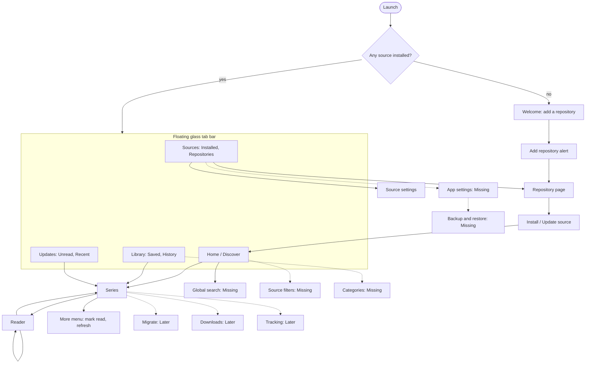

# Akidev: user flow

How people move through the app: every screen, the flows between them, and what is built. It rests on research
into existing manga and manhwa apps (section 1) and on what Akidev is: a **renderer** with **no sources of its own**,
which reads plugins people install from repositories they add by address. The look is in [DESIGN.md](DESIGN.md).

## 0. The product in one paragraph

You open the app and it is empty on purpose. You add a repository (a GitHub link, say), install a source from it, and
from then on it is a reader: browse a source, open a series, read in a long strip or in pages, keep a library, see new
chapters. There are no accounts, no coins, no ads, no web view. Sites that sit behind a Cloudflare or captcha check are not
supported, and the app says so plainly.

## 1. What the research found

Four groups of apps were researched on 2026-10-22. **Evidence is uneven**: official help pages often failed to load, so many
details are marked UNVERIFIED in the sources. Only what has a source is stated as fact below.

### 1.1 The apps, and what they teach

| Group | Apps | What they teach us |
| --- | --- | --- |
| Plugin readers | Mihon and forks (Komikku), Aidoku, Paperback, Kotatsu, Suwayomi, Cubari | The flows closest to ours: add a repository, install a source, browse, add to library, categories, updates, history, migration, backup. |
| Official webtoon platforms | WEBTOON, Tapas, Tappytoon, Lezhin, Manta, Pocket Comics | Series pages, episode-list states, vertical readers, subscribe and notify. Their monetisation is exactly what we leave out. |
| Publisher manga apps | MANGA Plus, Shonen Jump and Viz, K MANGA, Comikey, Manga UP!, Comic Walker | Updates and ranking tabs, "continue reading", paged right-to-left readers with spreads, free-chapter rules. |
| Self-hosted readers | Komga, Kavita, Suwayomi, and iOS clients such as Komic | Server connection flows, "keep reading" and "on deck", reader settings depth, offline and download controls. |

### 1.2 Patterns they share (with the evidence)

- **Top level is a handful of tabs.** Mihon: Library, Updates, History, Browse, More ([FAQ](https://mihon.app/docs/faq/browse)); MANGA Plus: Updates, Hottest, Browse, Creators, My Shelf ([Wikipedia](https://en.wikipedia.org/wiki/Manga_Plus)); Tapas: Library and More ([guide](https://ilona-andrews.com/how-to-use-tapas/)).
- **Updates and history are their own places**, not part of the library grid (Mihon, MANGA Plus, Komga's Keep Reading and On Deck).
- **A source or catalogue page has Popular, Latest and search with filters**; global search across all sources exists in Mihon ([getting started](https://mihon.app/docs/guides/getting-started)).
- **The series page is a header plus a chapter list with per-chapter state** (read, unread, locked, downloaded: Tapas' episode icons per [ScreensDesign](https://screensdesign.com/showcase/tapas-comics-and-novels)), and bulk actions in Mihon.
- **Library organisation is categories** (Mihon: long-press, Set categories, managed under More; update and download behaviour per category, [categories](https://mihon.app/docs/guides/categories)).
- **Readers offer paged right-to-left, paged left-to-right and long strip, with a per-series override**; tap zones with presets and inversion; background colour; keep screen on; a transition screen between chapters ([Mihon reader settings](https://mihon.app/docs/guides/reader-settings)). Komic adds zoom to 10x, wide-page splitting, per-book settings and time remaining ([App Store](https://apps.apple.com/app/id6744676973)). Lezhin has auto-scroll and a no-pause "Zen" mode ([App Store](https://apps.apple.com/us/app/lezhin-comics-premium-webtoons/id664973122)).
- **Backups include the library, categories, history, settings and repositories, but not the extensions or downloads** (Mihon, [backups](https://mihon.app/docs/guides/backups)); Aidoku's is Settings, Backups, create, export to Files ([backups](https://aidoku.app/help/guides/backups/)).
- **Migration between sources** is offered from a series and from a source (Mihon, [migration](https://mihon.app/docs/guides/source-migration); Suwayomi's skips outdated and incomplete matches).
- **Trackers** (AniList, MyAnimeList, Kitsu, MangaUpdates) log in under settings and appear as a button on the series page (Mihon, [tracking](https://mihon.app/docs/guides/tracking)).
- **Plugin apps ship nothing and endorse nothing**, and warn that a repository or extension has full access to the app (Mihon, [extensions FAQ](https://mihon.app/docs/faq/browse/extensions)); the one-tap "add repository" link from a community page is how people add one in practice.
- **iOS cannot promise background update checks**; refresh on open and on pull-to-refresh, with a best-effort background task (Apple's pages did not load, so this is general knowledge, UNVERIFIED against them).

### 1.3 What users complain about (so we avoid it)

- **Plugin readers:** Cloudflare errors, rate-limit bans, sources breaking when a domain changes, hidden sources (language filter or NSFW switch, with no hint why), no cross-device sync ([common issues](https://mihon.app/docs/guides/troubleshooting/common-issues)).
- **Commercial apps:** several currencies, expiring coins and unlocks, free-coin tasks that do not pay, ads at chapter ends, repeated age checks ([unstar ranking](https://unstar.app/blog/webtoon-tapas-manga-plus-tappytoon-lezhin-comic-reader-apps-ranked-2026)), notifications that fail silently (MANGA Plus, Tapas reviews).
- **Readers:** a dead pause or a forced portrait flip between chapters (Shonen Jump reviews), no way to see read state without downloading, slow loading and black screens.

### 1.4 Table stakes, nice to have, and what we leave out

| Table stakes (build) | Nice to have (later) | Leave out |
| --- | --- | --- |
| Tabs: browse, library, updates, sources; continue reading; global search; categories; sort and filter; reader modes, tap zones, resume, zoom, chapter transitions; backup and restore; clear error states | Migration, downloads and offline, local CBZ import, trackers, widgets, Spotlight, share sheet, per-series reader settings, incognito | Coins, passes, ads, accounts, comments, rankings we cannot compute, any web view |

## 2. People and what they want

| Person | First thing they do | What they need from the app |
| --- | --- | --- |
| **New** (arrives with an empty app) | Opens it, sees nothing | To be told in one screen what this is and how to add a repository, without the app naming any source. |
| **Reader** (has sources) | Opens, continues, reads | Continue in one tap, a reader that disappears, new chapters noticed. |
| **Collector** (many series, many sources) | Searches several sources, organises | Global search, categories, sort and filter, update feed, duplicates. |
| **Plugin author / power user** | Adds their own repository | Validation errors that say what is wrong, a way to see what a source does, settings per source. |
| **Self-hoster** (later) | Points the app at Komga, Kavita or Suwayomi | A server address and login as source settings (needs a format addition). |

## 3. Screen map

Status: **Built**, **Partial**, **Missing** (planned), **Later**.

### 3.1 Page inventory

| Page | Reached from | Holds | Status |
| --- | --- | --- | --- |
| **Welcome (first run)** | Launch with no source | What the app is, "Add a repository", a note that it includes no sources, "Import a file" (later) | **Partial**: Home shows an empty state with "Open Sources" |
| **Home / Discover** | Tab | Glass search, source chips, Popular and Latest pills, featured card, grid, "Show more" | **Built** |
| **Source filters** | Home (a filter button) | The filters a source defines (genre, status, sort) | **Built** |
| **Global search** | Home search with "All sources" | Results grouped per source, each filling in as it answers | **Built** |
| **Series** | Any grid or card | Hero, chips, Chapters, Bookmarks and Details pills, chapter cards, Continue, save, more menu | **Built** |
| **Reader** | A chapter | Strip, paged, right-to-left, zoom, resume, next chapter, glass chrome, auto-scroll, page bookmarks | **Built** |
| **Reader settings sheet** | Reader chrome | Mode, tap zones and inversion, background, orientation lock, keep awake, auto-scroll speed, brightness link | **Partial**: no tap zone presets or brightness link |
| **Library, Saved** | Tab | Grid with unread badges | **Built** |
| **Library, History** | Tab pill | Cards: series, chapter, date | **Built** (no delete) |
| **Categories** | Library menu, long-press a series, the series menu | Create, rename, reorder, delete; assign one series or several (Select); filter the grid by category or by none; Settings says what saving does (nothing, ask, or a chosen category) | **Built** |
| **Library sort and filter** | Library | Sort (last read, date added, title, unread, total chapters, latest chapter, random), reverse, remembered; filter (unread, category); *Missing:* source filter, grid size | **Built** |
| **Updates** | Tab | Unread and Recent cards, refresh | **Built** (no background refresh) |
| **Update errors** | Updates | Series whose source failed, with the reason | **Built** |
| **Sources, Installed / Repositories** | Tab | Cards, add, remove | **Built** |
| **Repository page** | Sources | Its sources with Install, Update, signed or not | **Built** |
| **Source settings** | Source row | The source's settings (language, content), remove | **Built** |
| **App settings** | Sources (or a gear) | Appearance, content (adult sources shown or hidden, language filter), reader defaults, storage and cache, backup, about and legal | **Missing** |
| **Backup and restore** | App settings | One file with library, progress, categories, repositories, source list, settings; restore reinstalls sources | **Missing** |
| **Migrate a series** | Series more menu | Pick another source, match, carry progress | **Later** |
| **Downloads** | Series and Library | Queue, per-chapter state, Wi-Fi only, auto-delete | **Later** |
| **Local import (CBZ, folders)** | Welcome and Library | Files picker, reads as a source of its own | **Later** |
| **Tracking** | Series, App settings | AniList and MyAnimeList login and sync | **Later** |

## 4. Flows

Each flow is the path a person takes, with the states they can land in. The bold step is where something can go wrong.

### 4.1 First launch to first read (the most important flow)

1. Launch. No source installed, so the **Welcome** screen shows: a short line on what the app is, a note that it includes and endorses no source, and **Add a repository**.
2. Paste an address (a GitHub link or any https folder with an `index.json`). Accept a pasted link from the clipboard when it looks like one.
3. **The repository is fetched.** Wrong address: "there is no index.json at …". Not a repository: the validation message. Unreachable: the network message with Try again.
4. The **Repository page** lists its sources with a "signed or not" note. Install one.
5. **The source is installed after its hash is checked.** A hash mismatch or a source that needs a newer app is shown on its row, not as a crash.
6. **Home** now shows that source: popular and latest. Tap a series, read.
7. After the first chapter the app suggests saving the series ("Save to follow new chapters"), once.

*Built:* steps 2 to 6 (typed address). *Missing:* the Welcome screen, clipboard paste, the one-time save hint.

### 4.2 One-tap add from a link (how people really add repositories)

A repository's page offers an **Add to Akidev** link. It opens the app on a confirmation sheet showing the repository's name, its address, whether it is signed, how many sources it lists, and the warning that a plugin decides which sites the app contacts. Confirm, and flow 4.1 continues at step 4. *Missing:* the URL scheme and the confirmation sheet.

### 4.3 Find something to read

1. **Home**: choose a source chip, or Popular and Latest, or type a search.
2. Results fill a grid; "Show more" loads the next page. A source with filters offers a filter button.
3. **Global search** (planned): one search across every installed source, results grouped by source as each answers; a slow or failed source shows its own state without blocking the rest.
4. Tap a title: **Series**.

States: loading, empty ("No results"), source unreachable (Try again), source needs a check (the "checks visitors first" card, section 4.8).

### 4.4 Read and continue

1. **Series**: "Continue · Chapter N" (or "Start") is always the primary action. Tapping a chapter card opens it at its saved place; the circle on the right toggles read.
2. **Reader** opens black. Centre tap shows or hides the glass bars; the menu switches long strip, pages left to right, pages right to left; the choice is remembered for the series.
3. Strip: the next chapter joins on below an end-of-chapter row. Paged: the last page is an end card with **Next**, and swiping on past it opens the next chapter. Both prefetch the next chapter, and both say when the source skips a chapter ("Chapter 179 is missing from this source").
4. Position is saved as chapter, page and how far down the page. Reopening goes to the same spot.
5. Leave with the back button; the series page shows the new read state and "Continue" moves on.
6. The list button in the reader's bottom bar (or a tap on the title) opens the series' chapters: each row is a name and a date, with an icon on the right only when something is true of it (read, begun, downloaded); the one being read is yellow with a play mark, and tapping one opens it at the page you were on, without going back to the series.
7. In the strip, the play button in the top bar scrolls by itself at the speed chosen in the reader sheet; a finger on the strip pauses it and it carries on a second after the finger lifts. The bookmark button beside the page count marks the page on screen (and how far down it, in the strip); the series page's **Bookmarks** tab lists them, and tapping one opens the reader there.

*Built:* all of it. *Missing:* tap zone presets in the reader sheet, a chapter jump list, a brightness hint, incognito.

### 4.5 Save, follow, get new chapters

1. Bookmark on the series page saves it to **Library**.
2. **Updates** shows saved series with unread chapters, newest first, with a badge on the tab icon.
3. Refresh (pull or the button) asks every source for the saved series' chapters; a series whose source failed is listed with the reason under **Update errors** (planned).
4. iOS cannot promise background checks, so the app also refreshes when it opens and says so in settings: "Akidev checks for new chapters when you open it".

*Built:* 1 to 3 (no error list). *Missing:* refresh on open, a best-effort background task, update errors.

### 4.6 Organise a growing library

Long-press a series for a menu (Open, Mark read, Move to category, Remove). **Categories** appear as pills above the grid. Library sort and filter live behind one glass button (seven orders and reverse, remembered; unread only; Select to put several series on categories, mark them read or remove them; Categories to manage the shelves). A series' cover can be changed from its menu (a photo, or a page from the reader sheet) and reset. *Missing:* source filter, grid size.

### 4.7 Keep sources healthy

1. **Sources** shows each installed source with its version and an "Update" mark when its repository has a newer one (updates also install at app start).
2. A source that no longer loads (its theme changed, or it needs a newer app) stays listed, marked, with a reason and Remove.
3. A repository whose key changed is refused with a plain explanation; the person can remove and re-add it to trust the new key.
4. Per-source **settings** (language, content) are one tap from the source row.

*Built:* 1, 3, 4. *Partial:* 2 (a broken source is only logged).

### 4.8 When something fails (one vocabulary of error cards)

| Situation | Card says | Next step |
| --- | --- | --- |
| No network | "No connection" | Try again |
| Site did not answer or changed its pages | "This source did not work" + the reason (has the site changed?) | Try again, Check for a source update |
| Site wants a check (Cloudflare, captcha) | "This site checks visitors first": the app has no browser to pass it | Try another source, or read it through a server you run (later) |
| Source needs a newer app | "Needs Akidev N or newer" | Update the app |
| Repository changed hands (key) | "This repository now uses a different key" | Remove it and add it again if you trust it |
| File does not match the index | "A file was not what the repository listed" | Try again later; tell the repository's owner |
| Adult source and adult content off | The source is listed but marked "18+, hidden in settings" (never silently absent, Mihon's hidden-source complaint) | Open settings |

### 4.9 Back up and restore (planned)

Settings, Backup: create one file (library, progress, categories, history, repositories, installed source list and their settings, app settings; **not** downloads), shown in the share sheet to save to Files or iCloud Drive. Restore: open the file; the app lists what it will restore, re-adds the repositories and reinstalls the sources from them (hash-checked), then puts the library and progress back. Sources that can no longer be installed are listed, not dropped. *Missing.*

### 4.10 Later flows, sketched

- **Migrate:** Series, More, Migrate. Choose a source, the app searches it for the same title and shows matches; confirm and read progress carries over (by chapter number).
- **Downloads:** a download arrow on the chapter card and in the series menu, a queue in Library, Wi-Fi only, auto-delete after reading, never expiring.
- **Local files:** Files picker or Open in. CBZ, folders and PDF become a source called "On this device".
- **Trackers:** Settings, log in to AniList; a button on the series page; progress syncs as you read.
- **Self-hosted servers:** a source whose address and login are settings, for Komga, Kavita and Suwayomi.

## 5. Principles for the flows

1. **Never leave the person on a blank screen.** Every empty or error state is a card with a reason and a next step.
2. **The app names no source.** Welcome says what a repository is and where to paste one.
3. **One primary action per screen.** Series: Continue. Home: the search. Repository: Install.
4. **Reading is never interrupted.** No prompts, no pauses between chapters, chrome hides on tap.
5. **Everything the plugin decides is visible.** Which repository a source came from, its version, whether the repository is signed.
6. **No accounts.** A backup file is the only thing that leaves the device, and only when the person shares it.
7. **Say what iOS cannot do.** Background refresh is best effort, and the app says so.

## 6. What to build, in order

| Priority | Item | Why |
| --- | --- | --- |
| P0 | Welcome screen, clipboard paste, one-tap add link and confirmation sheet | Flow 4.1 and 4.2 are the first minute of every new person's life |
| P0 | App settings (appearance, adult content and language filters, reader defaults, storage, about) | Needed for the "hidden source" states and for the reader defaults |
| P0 | Reader settings sheet (tap zones, background, orientation, keep awake) | Table stakes in every reader surveyed |
| P0 | Source error vocabulary in 4.8, with the broken-source row in Sources | Plugin readers' top complaint is sources breaking without explanation |
| P1 | Global search across sources | Collectors' first need; Mihon has it |
| P1 | Source filters UI | The engine already accepts them |
| P1 | Library categories, sort and filter, long-press menu | Table stakes for a growing library |
| P1 | Backup and restore | Plugin apps lose people their setup without it |
| P1 | Refresh on open, best-effort background refresh, update errors | The Updates tab is only as good as its freshness |
| P2 | Local CBZ import, downloads, migration | Most requested "later" features in the surveyed apps |
| P2 | Trackers, widgets, Spotlight, share sheet, self-hosted sources | After the core is solid |

## 7. Open decisions for the owner

1. **Adult content:** a global switch in settings that hides sources flagged adult (they stay listed, marked), or no adult sources at all in our own repository (already true)?
2. **Categories or tags** for the library: categories (Mihon's model, simple) or free tags?
3. **Global search first, or categories first**, if both cannot fit before the next test build?
4. **Comments:** the webtoon apps all have them. We have no server, so none. Agreed?
5. **Where backups go:** the share sheet only (Files, iCloud Drive), or an automatic iCloud copy later?

## Sources

Plugin readers: [Mihon docs](https://mihon.app/docs/guides/getting-started), [categories](https://mihon.app/docs/guides/categories), [reader settings](https://mihon.app/docs/guides/reader-settings), [backups](https://mihon.app/docs/guides/backups), [migration](https://mihon.app/docs/guides/source-migration), [tracking](https://mihon.app/docs/guides/tracking), [extensions FAQ](https://mihon.app/docs/faq/browse/extensions), [Komikku](https://github.com/komikku-app/komikku), [Aidoku](https://github.com/Aidoku/Aidoku), [Aidoku backups](https://aidoku.app/help/guides/backups/), [Paperback](https://github.com/paperback-ios/app), [Kotatsu](https://github.com/KotatsuApp/Kotatsu), [Suwayomi](https://github.com/Suwayomi/Suwayomi-Server), [Cubari](https://cubari.moe/).
Webtoon platforms: [WEBTOON](https://apps.apple.com/us/app/-/id894546091), [Tapas](https://screensdesign.com/showcase/tapas-comics-and-novels), [Lezhin](https://apps.apple.com/us/app/lezhin-comics-premium-webtoons/id664973122), [platform guide](https://kcomicsbeat.com/2024/09/25/guide-to-webtoon-platforms/), [app ranking](https://unstar.app/blog/webtoon-tapas-manga-plus-tappytoon-lezhin-comic-reader-apps-ranked-2026).
Publisher apps: [MANGA Plus](https://apps.apple.com/US/app/id1442476536), [Wikipedia](https://en.wikipedia.org/wiki/Manga_Plus), [Shonen Jump](https://apps.apple.com/us/app/-/id594237344), [K MANGA](https://apps.apple.com/app/1637040002), [Comikey](https://apps.apple.com/us/app/comikey-manga-webcomics/id1601348237).
Self-hosted and UX: [Komga](https://komga.org/docs/introduction), [Kavita wiki](https://wiki.kavitareader.com/), [Komic](https://apps.apple.com/app/id6744676973), [comic reader UX](https://uxdesign.cc/the-best-ux-for-comics-so-far-b0c75bc76c03).

## Build status (2026-10-22)

Built and run in the simulator: welcome with clipboard paste, add-repository sheet and `akimanga://add-repo?url=` link,
settings (appearance, 18+ and language filters, reader defaults, backup and restore, CBZ import, about), source filters
sheet, global search across sources, library categories with sort, unread filter and long-press menu, chapter downloads
read offline, forget series, move a series to another source, reader settings sheet (mode, background, orientation,
tap sides, keep awake), per-source problems shown in Sources, update errors in Updates, refresh on open and a
best-effort background refresh.

Not built: local notifications for new chapters, Wi-Fi-only and delete-after-reading downloads, trackers and
self-hosted server sources (the last two wait on owner decisions).
